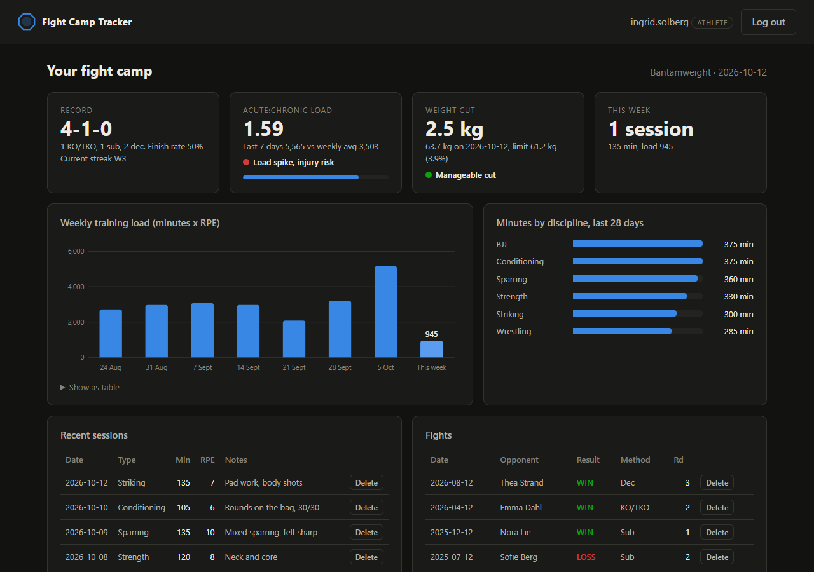
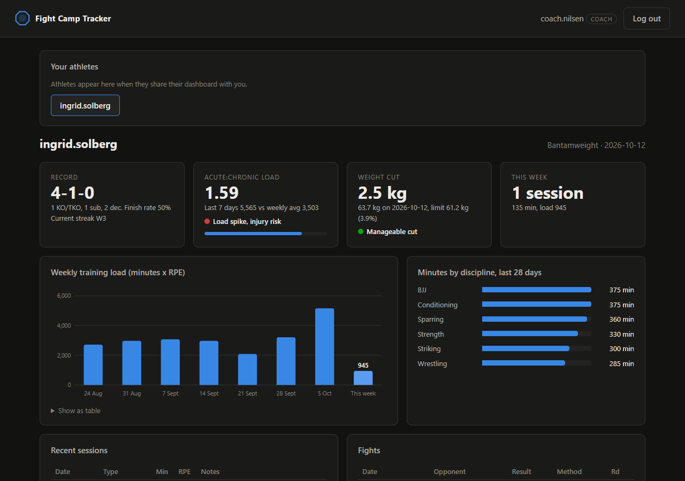
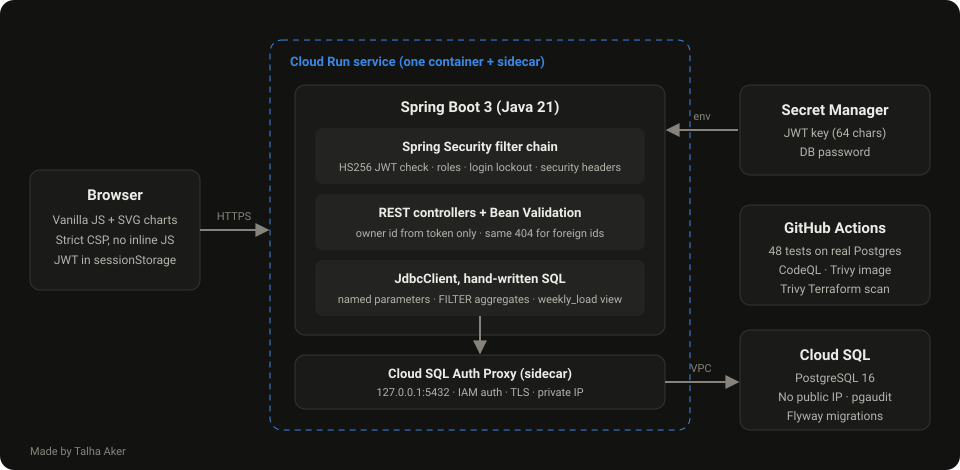

# MMA Fight Camp Tracker

[](https://github.com/t4lh8/MMA-Fight-Camp-Tracker/actions/workflows/ci.yml)
[](https://github.com/t4lh8/MMA-Fight-Camp-Tracker/actions/workflows/codeql.yml)


A web app for MMA fighters to track a fight camp: training load, fight record and weight cut.
A coach can get read-only access to an athlete's dashboard.

MMA is my main hobby, and this is the kind of tool I would want during a camp. I also used it
to practise secure web development in Java: every security control in the app has a test that
proves it works.



All names, clubs and events in the screenshots are made up demo data.

## Features

**For the athlete**

- **Training log**: striking, wrestling, BJJ, sparring, strength and conditioning, with minutes and effort (RPE 1-10).
- **Training load**: load = minutes x RPE (the session RPE method). The dashboard compares the last
  7 days with the average week of the last 28 days (acute:chronic ratio) and warns about sudden spikes.
- **Fight record**: W-L-D, KO/TKO, submission and decision wins, finish rate and current streak.
- **Weight cut**: latest weigh-in against the weight class limit, in kg and as a percentage of body weight.
- **Coach sharing**: share a read-only view with a coach and take it back at any time.
- **Account activity**: your own login history, so you can spot logins that were not you.

**For the coach**

- A list of athletes who shared with them, and each athlete's dashboard in read-only mode.



## Security

| Control | How | Proven by |
|---|---|---|
| Password storage | BCrypt, cost 12 | `AuthTest.passwordIsStoredAsBcryptHash` |
| Password policy | At least 12 characters, no common passwords, must not contain the username (NIST SP 800-63B style) | `AuthTest.weakPasswordsAreRejected`, `UnitTest.passwordPolicy` |
| Brute force | Account locked for 15 min after 5 failed logins, `429` + `Retry-After` | `AuthTest.accountLocksAfterFiveFailedLogins` |
| User enumeration | Same answer for wrong password and unknown user. A dummy BCrypt check keeps the timing similar | `AuthTest.wrongPasswordAndUnknownUserGiveTheSameAnswer` |
| Tokens | HS256 JWT, 30 min lifetime, algorithm pinned, issuer checked. The app will not start with a key shorter than 32 bytes | `expiredTokenIsRejected`, `tokenSignedWithAnotherKeyIsRejected`, `unsignedAlgNoneTokenIsRejected` |
| Broken object level authorization (OWASP API1) | Every query has `WHERE owner_id = :owner`, and the owner always comes from the token | `AccessControlTest.athleteCannotDeleteAnotherAthletesSession` |
| Id probing | Someone else's id and a missing id give the same `404` | `AccessControlTest.missingAndForeignIdsLookTheSame` |
| Mass assignment | Request bodies are records, unknown JSON fields are rejected | `AccessControlTest.ownerIdInTheBodyIsRejected` |
| Roles | Athlete and coach endpoints are separated, anything not listed is denied | `AccessControlTest.rolesAreEnforced` |
| Sharing | A coach without access gets `404`, and the attempt is written to the audit log | `coachNeedsTheAthletesPermission`, `deniedCoachAccessIsAudited` |
| SQL injection | Only named parameters, no string concatenation in SQL | `TrainingApiTest.sqlInPlainTextFieldsIsStoredAsText` |
| Input validation | Bean Validation plus `CHECK` constraints in the database | `TrainingApiTest.outOfRangeValuesAreRejected` |
| XSS | The frontend only uses `textContent`. A strict CSP blocks inline scripts | `AuthTest.securityHeadersAreSet` |
| Error handling | Short JSON errors, no stack traces or SQL errors to the client | `TrainingApiTest.malformedJsonGivesAShortError` |
| Deleted accounts | A token stops working when its account is deleted | `AuthTest.deletedAccountsTokenStopsWorking` |

The CI pipeline also runs **CodeQL** (Java and JavaScript), scans the Docker image with **Trivy**
and fails on any fixable HIGH or CRITICAL vulnerability. Dependabot keeps Maven, Actions and the
base image up to date.

## Architecture



- **Backend**: Java 21, Spring Boot 4.1, Spring Security (OAuth2 resource server for JWT), Bean Validation.
- **Database**: PostgreSQL 16, schema managed by Flyway. Hand-written SQL with Spring's `JdbcClient`, no ORM.
- **Frontend**: one HTML page, plain JavaScript and SVG charts. No build step, no external scripts.
- **Container**: multi-stage build on a distroless Java image. No shell, runs as a non-root user.
- **Cloud**: Terraform for Google Cloud. Cloud Run, Cloud SQL with private IP only, Secret Manager and its own service account.

### SQL

Some of the SQL in [`V1__schema.sql`](src/main/resources/db/migration/V1__schema.sql) and
[`StatsRepository`](src/main/java/io/github/t4lh8/fightcamp/stats/StatsRepository.java):

```sql
-- 7-day and 28-day load in one pass
SELECT COALESCE(SUM(duration_min * rpe) FILTER (WHERE session_date > CAST(:today AS date) - 7), 0) AS acute,
       COALESCE(SUM(duration_min * rpe), 0) AS load28
FROM training_session
WHERE owner_id = :owner
  AND session_date <= CAST(:today AS date)
  AND session_date > CAST(:today AS date) - 28;

-- The database refuses data that makes no sense, even if the API had a bug
CHECK (result IN ('WIN', 'LOSS') OR method IN ('DECISION', 'OTHER'))
```

## Run it

### With Docker Compose (app + database + demo data)

```bash
cp .env.example .env
# fill in DB_PASSWORD and JWT_SECRET, for example with: openssl rand -base64 48
docker compose up --build
```

Open http://localhost:8080 and log in with the fake demo accounts:

| User | Role | Password |
|---|---|---|
| `ingrid.solberg` | Athlete | `Demo-Bantam-Oslo-26` |
| `coach.nilsen` | Coach | `Demo-Bantam-Oslo-26` |

The demo accounts only exist when the `demo` profile is on.

### Tests

Needs Java 21, Maven and Docker (Testcontainers starts a real PostgreSQL):

```bash
mvn verify
```

48 tests: 34 integration tests against PostgreSQL 16 and 14 unit tests.

### Google Cloud

[`deploy/gcp`](deploy/gcp) sets up the whole thing on Google Cloud:

```bash
cd deploy/gcp
cp terraform.tfvars.example terraform.tfvars   # set project_id and image
terraform init && terraform apply
```

**Status:** the Terraform passes `terraform validate` and a Trivy misconfiguration scan
(0 findings), and CI checks both on every push. I have **not** applied it to a real Google
Cloud project yet, so the deploy itself is untested.

## What I learned

- Spring Security's resource server: validating my own JWTs, pinning the algorithm and mapping roles from claims.
- How broken object level authorization happens, and that the fix belongs in the query, not in an `if` after it.
- Writing SQL by hand with `FILTER`, views and `CHECK` constraints, instead of letting an ORM hide it.
- Integration tests against a real database with Testcontainers. A mocked database would not have caught my `CHECK` constraints or date math.
- Content Security Policy in practice: no inline scripts or styles, and DOM building with `textContent` only.
- Cloud Run with a Cloud SQL Auth Proxy sidecar, private IP for the database and secrets from Secret Manager.

## What surprised me

- **My first image had CRITICAL vulnerabilities.** I started on Spring Boot 3.5.6. Trivy found
  critical issues in Tomcat, Spring Security and Spring MVC, and the 3.5 line no longer gets free fixes. Moving to
  Spring Boot 4.1 was a major version jump (Jackson 3, Testcontainers 2), but the tests let me do it
  in one go. Even then Tomcat and Jackson needed newer patch releases than Spring Boot's defaults.
  The image now has 0 fixable HIGH or CRITICAL findings.
- **Trivy flagged my database.** My first Terraform gave Cloud SQL a public IP, "protected" by having
  no authorised networks. Trivy marked it HIGH. I moved it to a private VPC instead.
- **The chart highlighted the wrong bar.** I used a CSS `+` selector for hover, and it picked the
  next week's bar. I only saw it on a real screenshot, not in the tests.

## Limitations

- The login lockout counter is kept in memory, so it only works with one instance. The Cloud Run
  config is capped at one instance for that reason. More instances would need a shared store like Redis.
- The lockout is per username. An attacker who knows a username can lock that account for 15 minutes.
  Per-IP limits at the edge (for example Cloud Armor) would be the next step.
- The token is kept in `sessionStorage`. An `HttpOnly` cookie would hide it from scripts, but would bring CSRF protection into play.
- The workload and weight cut thresholds are simple rules for a hobby project, not medical advice.

## License

[MIT](LICENSE)

Made by **Talha Aker**.
